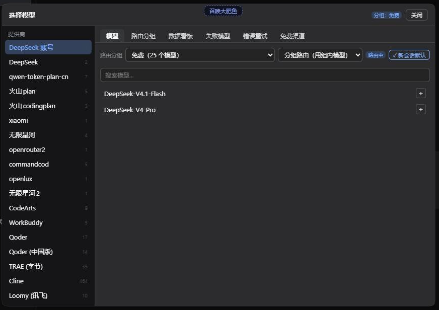
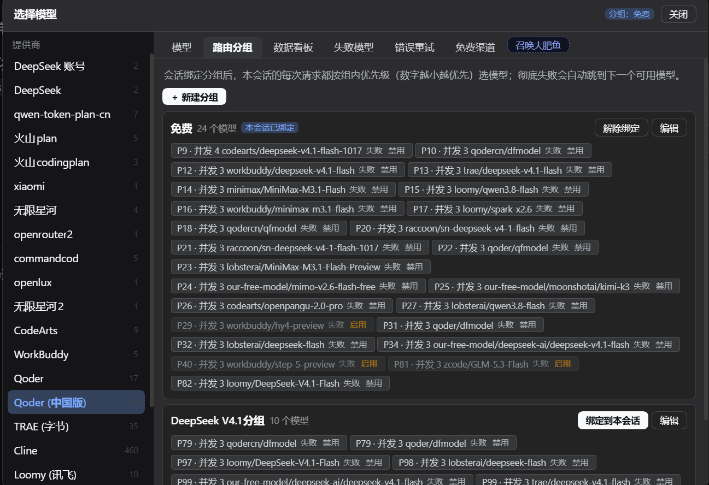

# model-failover-manager

DSH 插件：把 composer 的模型选择位换成带「路由分组」的选择弹窗，并在模型彻底失败后自动切换到组内下一个可用模型。

> 界面里叫「模型故障转移」。设置入口：**设置 → 模型故障转移**。





---

## 它做什么

- **接管模型选择位**：以 `priority: -1` 注册 `conversation.input.model`，遮蔽内置选择器。
  - 打开「弹窗模式」时为左右分区弹窗（左：供应商，右：模型），含「路由分组」「失败模型」两个页签。
  - 关闭时为紧凑下拉。
  - 触发按钮显示 **供应商 · 模型名 · 思考强度**；已绑定分组时另有一个分组徽标。
- **路由分组**：可建多个分组，每组是一份有序模型列表（`priority` 决定尝试顺序）。
  - 每个模型可配**生效时段**：多段，两端包含（`from` 与 `to` 都算在时段内），`from > to` 表示跨午夜（如 22 → 6）。
  - 每个模型可配**截止日**，过期后不再参与路由。
  - 时段未配置、为 `null` 或空字符串，一律视为「全天」。
- **两种绑定模式**
  - `route`：用绑定分组里的模型（会实际改变会话当前模型）。
  - `failover`：保持会话当前模型，只有它彻底失败后才兜底切到组内下一个。
- **失败后自动续跑**：监听 `agent/request-error`，以 prepend 注册并先 `await next()`，因此**一定是在所有重试策略都表态放弃之后**才接手（包括 `llm-error-retry` 预算耗尽后直接短路整条链的情况）。接手后标记失败、切换到组内下一个可用模型，并自动续跑，不用你重发。
  - 续跑不是「同一轮内重试」：新版 dsh 在**步骤准备（pre-step）**时就把本步用于请求的 `provider/model/effort` 固定下来，`agent/request` 已废弃，在那里改模型会让宿主直接报错并让整轮崩掉。所以失败后切换走 `agent.model.select()`（写一条 durable `model/selection`，从下一个步骤生效），并在该会话回到 `idle` 后补一条续跑消息开下一轮。
- **每轮健康检查**：每次发消息（驱动器刚启动、尚未进入 `pre-step` 的窗口）都判定一次「这个会话此刻要用的模型现在还能不能用」——仍可用就保留（不覆盖你手选的模型），只有它此刻在分组内不可用（被标记当日失败、超出北京时间时段、过了截止日）才切到组内下一个可用模型；当前模型压根不在分组里时不插手。判据都是「此刻」的，时段与截止日随时间变化、失败标记会被重置或过期。
- **子代理继承路由（默认行为）**：「子代理跑什么模型」由宿主在创建时决定——它把父会话请求头里的 `provider/model/effort` 复制成子代理的 AgentOptions。本插件**不写任何选择去覆盖它**，所以子代理天然继承父会话当前实际在用的模型（父会话切到组内第 2 个，子代理也跑第 2 个，不会被拽回第 1 个）。分组绑定同样沿 `session.header.parentSession` 向上继承；只有继承来的模型此刻不可路由（已失败/不在时段/过截止日）时才按组内优先级换一个。
- **子代理可单独选模型/分组**：子代理会话的资源位里同样能换模型、绑分组，选中即只作用于该子代理（走 `agent.model.select()`，不经宿主对子代理一律拒绝的 `sessionController.selectModel`）；它的分组选择不参与「新会话默认分组」。
- **默认分组**：新会话（startup/clear）自动沿用上次的选择（分组 + 模式）；`resume` / `compact` 不动，尊重旧会话既有选择。
- **在分组里直接停用模型**：路由分组页签里每个模型块都带两个开关——「失败」把它标记为当日失败（与自动失败共用同一份记录：日界线到期、会话成功一轮、或点「恢复」都会解除，`code=MANUAL`），「禁用」则把它**持久**挡在所有分组之外（写进分组条目的 `disabled` 字段，不随日期恢复，只由你手动「启用」解除）。两者互不覆盖：`routable()` 先判禁用再判失败。
- **失败模型记录**：按「使用日」记录失败模型（北京时间，日界线默认早上 8:00，见 `failResetHour`），同时保存失败原因（错误码 + 最近一次错误信息）。在弹窗的「失败模型」页签里可展开查看原因，也可逐个或一键全部恢复。到日界线自动过期；会话成功完成一轮也会立即恢复对应模型。所有时间口径固定按北京时间计算，与宿主机时区无关。
- **压缩旁路守卫（`compactionGuard`）**：`billion-context` 生效时，`qoder` / `qodercn` 这类走 WASM 加密端点的 provider 拿不到任何上下文压缩；插件把这类 provider 降为分组里的兜底候选，并在 `/status` 里标出被降级的模型与此刻正跑在无压缩链路上的会话。见「与 billion-context 的配合」一节。
- **交还控制权**：你手选模型、解绑分组或删除分组后，插件即不再接管该会话的模型。
- **换账号只对 Our Free Model 的模型生效**：少数历史上的渠道退役后账号还留在该插件的池里，因此「池里有这个 provider 的账号」不等于「这个 provider 归它管」。`codearts`（由 `dsh-codearts` 提供、账号由它自己的池管理）默认不在换号范围内，失败直接走分组路由，见 `ofmHandoffExcludeProviders`。

## 与 Our Free Model 的配合

若失败的模型属于 `dsh-our-free-model` 提供的渠道，插件会**先尝试换账号**，而不是直接换模型：

- 不论错误类型，只要该模型还有别的可用账号，就换账号重试一轮；账号试完仍失败才交给分组路由换模型。
- 换号通过给账号写一个**池级冷却标记**实现，让该渠道适配器下次选号时跳过刚失败的账号。
- 插件**不读取也不修改**该渠道的凭据；只通过它注册的 `accountPool` 服务调用 `getAvailableAccount` / `updateModelRateLimit` / `listAccountsByProvider`。
- 未安装该插件时，这段逻辑静默跳过。
- 「属于哪个插件」由 `ofmHandoffExcludeProviders` 决定，而不是由池里有没有账号决定：池是按 provider 字符串存的持久表，渠道退役后账号条目仍在，只看账号会把别的插件提供的模型也卷进换号流程（例如 `codearts` 的 429 被当成换号，冷却一个本次没用到的账号，还挡掉了本该发生的分组路由）。默认排除 `codearts`。

## 与 dsh-codearts 的配合

`dsh-codearts` 有一个已知的失败模式，本插件会兜住：**报「429 没有可用账号」，但账号和积分都正常**。

它的 `chatCompletions` 里，`pool.pick()` 从第一次就返回 `undefined` 时一个上游请求都不会发出去，直接回这句 429 —— 真实含义是「本地池挑不出号」。而它的账号池只有 `coolUntil`（冷却，成功或到期可清）和 `disabled`（停用，**没有任何清除路径**）；`disabled` 由 `session_dead` 写入，而它的 `classify()` 把 HTTP 401 和 403 都判成 `session_dead` —— 上游偶发一次 403（临时凭证临期、并发上限、权益校验）就让该号永久停用，两个号都撞上后池彻底变空，此后每次请求都是这句 429，直到重启宿主。

本插件的处置：识别这句固定文案 → 重启承载 `dsh-codearts` 的 Loader 条目（`entry.fiber.restart()`，让它重新 apply、重建账号池；不写配置、不改 cordis.yml、不重启整个宿主）→ 等它的 provider 重新注册回 `llm` 注册表 → 同一步重试（selection 没变，retry 安全）。30 秒冷却防抖；自救失败时不把模型标成「当日失败」，也不切模型，只记一条诊断。

## 与 billion-context 的配合

`billion-context`（bili）在 DSH 里是**唯一的上下文压缩器**：它一生效，`bili-compaction-gate` 就把宿主自带的 `compaction-basic` 置为 `disabled`。而 bili 的原生通道只改写它认得的模型端点——`/chat/completions`、`/v1/messages`、`/completions`、`/responses`、`/conversations` 与 Gemini 的 `/models/<name>:<method>`，其它 POST 原样直发、不压缩。

`qoder` / `qodercn` 的推理走 WASM 加密端点 `POST /algo/api/v2/service/pro/sse/agent_chat_generation?Encode=1`：正文由 WASM 加密，`Authorization` 是 WASM 生成的 `COSY.<payload>.<sig>` 签名，bili 既认不出这个路径，也没有它的密文编解码器。两件事叠加的后果是：这些会话既没有 bili 压缩，也没有宿主自带压缩，历史只涨不降，bili 的压缩工具也不在请求里，最终在上下文上限处硬失败。

这是硬约束，不是本插件要绕开的缺陷：压缩的前提是读出明文正文，而解密与签名都由 qoder 的 WASM 持有，bili 那条链路上没有谁代劳。插件不解密，而是**把请求改道**（见下节）。万一 shim 不可用——配置里关掉了、`dsh-codearts-auth` 不在、或者 bili 没启用——守卫负责「别让它悄悄发生、别把路由往这条链路上推、把修法说清楚」：

1. **路由降级**：分组里只要有压缩代理看得见的模型，`pickCandidate` 就优先选它们；名单内的 provider 只在全组都不可压缩时才作为兜底被选中。既不把用户往无压缩链路上推，也不让只配了 qoder 的分组变成「无模型可用」。
2. **失败留痕**：名单内 provider 的请求失败时，仍按原流程标记当日失败并切换，同时把结论写进 `/status.compressionGuard.lastDiagnosis`（带一行可执行的修法），并给 `failureLog` 的对应条目挂 `uncompressed: true`，排障时一眼看出这次失败发生在没有压缩的链路上。
   - 这类失败重试没有意义、换模型才有意义；换到哪个由分组路由决定，诊断不改变切换路径。
3. **判定 bili 是否在压缩**：只读全局量 `__BILI_DSH_COMPACTION_VERDICT__`，值为 `'active'` 才算在压缩。它由 bili 在 dsh-native 的 `apply(ctx)` 里、`plan.mode !== 'off'` 时无条件置位——只要 bili 原生通道启用就是 `active`，不需要压缩代理真的连上，也不依赖端口、鉴权与网络；`bili-compaction-gate` 读的是同一个量，两边判定不会分叉。bili 没启用时宿主自带压缩还在跑，这些 provider 照常有压缩。

### qoder 压缩 shim

上面的「路由降级」只是避让；真正的解法是把 qoder 的请求改成 bili 认识的协议跑一趟：**明文进 bili，压缩完再还原成 qoder 的加密 wire**。落地成两段：

1. **换掉请求**：`QoderEncryptedInfer#prepareInfer` 被替换，不再返回 WASM 加密请求，而是返回一个明文 OpenAI 请求指向本机 shim（`http://127.0.0.1:47001/qoder/<rid>/chat/completions`）。路径以 `/chat/completions` 结尾，正是 bili 原生通道认得的那几种之一；`rid` 放在路径段而不是查询串，因为中继层可能改写或剥离查询串。
2. **压缩后还原**：这次 `fetch` 发生在会话回合内，bili 会带上会话归属、把 `messages` 压缩，再转发回 shim。shim 用压缩后的 `messages` 重建 qoder 的 `ask`（`history` 本来就是 OpenAI 形状，映射几乎是恒等变换，系统消息、工具定义、采样参数原样带回），调用**原始** `prepareInfer` 重新加密，用 `node:https` 直连 qoder。上游 SSE 原样穿回 adapter，响应方向不需要翻译；凭据也不需要复制——shim 复用的正是被截获的那个 WASM 上下文（`this`）。

为什么不做响应方向的协议翻译：qoder 的响应本来就是 OpenAI 形状的 SSE 包了一层信封，adapter 自己会拆；这边只动请求方向。

#### 补丁打在哪个加密器上

这是整件事最容易踩空的地方：**运行时真正在用的 `QoderEncryptedInfer` 不是 `dsh-codearts-auth` 里的那份**。`dsh-our-free-model` 把整个 qoder adapter 与 WASM 桥**内联打包**进自己的 `vendor/channel-pack/pack.js` 并在那里注册 `qoder` / `qodercn` —— 它是模块局部变量，不导出、也不在任何可遍历的对象图上（Cordis 的访问守卫还会挡住对 adapter 对象图的读取）。给独立包打补丁后，真实请求照发加密端点，而计数一直是 0。

所以 shim 按三条线索找目标，命中几条打几条：

| 线索 | 何时命中 |
| --- | --- |
| `globalThis.__mfQoderEncryptor` | `pack.js` 里带注入口（本插件会补这一行） |
| 磁盘上 `dsh-codearts-auth/lib/qoder-wasm.js` | 有些装机方式下 qoder 不由 `dsh-our-free-model` 接管 |

⚠️ 注意同一文件的两个 URL 变体（Windows 盘符大小写 `file:///D:/` 与 `file:///d:/`）在 Node 的 ESM 缓存里是**两个不同的模块实例**，各有一份类。shim 会逐个 import 并全部打补丁，所以 `/status.qoderShim.targets` 里通常能看到两条 `wasm:` 加一条 `pack:`。

**注入口会被升级覆盖**：`dsh-our-free-model` 的自更新会用官方发布包整份替换 `pack.js`，那一行随之消失。所以 shim 每次装载都核对一次，缺失时自动补回，结果写在 `/status.qoderShim.hookRepair`；补的是别人的包，因此只在**确实缺失且能唯一定位类定义末尾**时动手，定位不唯一就只报告不动文件。

三个配置项：

| 键 | 默认 | 说明 |
| --- | --- | --- |
| `qoderShim` | `true`（本仓库的 patch 里显式写 `true`） | 总开关。关掉后回到「路由降级 + 诊断」的老行为 |
| `qoderShimPort` | `47001` | shim 监听端口，只绑 `127.0.0.1` |
| `qoderShimWasmPath` | 自动探测 | 显式指定 `qoder-wasm.js` 的绝对路径；默认在 `$DSH_HOME/profiles/*/node_modules/dsh-codearts-auth/lib/` 下找 |

装不上（模块缺失、导出对不上、端口占用）只告警并自动退回直发，不会阻断插件启动；原因写在 `/status.qoderShim.lastError` 里。

两处细节值得知道：

- **shim 自己也能热更新**：监听端口与 prototype 补丁放在进程级 `globalThis` 槽里，宿主用带构建号的动态 `import` 装载模块。改完 shim 代码后重载插件，同端口再装一次只更换「请求处理实现」，服务器与既有 keep-alive 连接都不重建，因此不会打断进行中的请求。
- **`rid` 不会用完即删**：adapter 遇到 409 `duplicate_request`、或排队（`model_queued`）之后会原样重发同一个请求，那时 `rid` 必须还能命中，否则重发会变成 410。条目只按 TTL（120 秒）与容量（256 条）淘汰。

「压缩旁路」要四个条件同时成立：`compactionGuard` 开着、provider 在 `uncompressedProviders` 名单里、bili 此刻在压缩，**并且** shim 没有接管它。前三条缺一条都不算；shim 装上之后 qoder/qodercn 的请求已经以明文进 bili，压缩照常发生，因此它们自动退出这份名单、路由也不再被降级。

两个配置项：

| 键 | 默认 | 说明 |
| --- | --- | --- |
| `compactionGuard` | `true` | 总开关。关掉后名单内的 provider 恢复原优先级参与路由，失败也不再打压缩旁路诊断 |
| `uncompressedProviders` | `["qoder", "qodercn"]` | 声明哪些 provider 的端点注定绕过 bili 压缩。写成 `[]` 表示一个都不声明，效果等同于关掉守卫 |
| `qoderShim` | `false` | 打开 qoder 压缩 shim：明文进 bili、压缩后重新加密出上游。见「qoder 压缩 shim」 |
| `qoderShimPort` | `47001` | shim 监听端口，只绑 `127.0.0.1` |
| `qoderShimWasmPath` | 自动探测 | 显式指定 `qoder-wasm.js` 绝对路径 |

### 在 `/status` 里看

`/status` 的 `compressionGuard` 是守卫此刻的现场（只读）：

```json
"compressionGuard": {
  "enabled": true,
  "biliActive": true,
  "uncompressedProviders": ["qoder", "qodercn"],
  "shimCovered": ["qoder", "qodercn"],
  "downgradedModels": [{ "groupId": "g-1", "provider": "qoder", "model": "..." }],
  "degradedSessions": [{ "sessionId": "...", "provider": "qoder", "model": "..." }],
  "lastDiagnosis": { "at": 1730000000000, "provider": "qoder", "model": "...", "code": "CONTEXT_LENGTH_EXCEEDED", "hint": "billion-context（bili）现在是唯一的压缩器，但…" }
}
```

- `enabled` / `biliActive`：守卫开没开、bili 此刻是不是唯一压缩器。任一为 `false`，下面两份名单都说明不了「此刻真的拿不到压缩」。
- `uncompressedProviders`：生效中的名单。
- `shimCovered`：名单里已被压缩 shim 改道的 provider。它们不再计入 `downgradedModels` / `degradedSessions`——请求已经以明文进 bili，压缩照常。
- `downgradedModels`：所有启用分组里会被降为兜底的条目，最多 50 条。不剔除当日失败、超出时段、过了截止日的条目——它们本来也不参与路由。
- `degradedSessions`：本插件已接管、且生效模型落在名单里的会话，也就是此刻正跑在无压缩链路上的那些。
- `lastDiagnosis`：最近一次压缩旁路失败的结论（`at` 是毫秒时间戳）；一次都没发生过时为 `null`。

`/status.qoderShim` 是 shim 此刻的现场：

```json
"qoderShim": {
  "enabled": true, "installed": true, "port": 47001,
  "wasmPath": "…/dsh-codearts-auth/lib/qoder-wasm.js",
  "targets": ["wasm:…qoder-wasm.js", "wasm:…qoder-wasm.js", "pack:__mfQoderEncryptor"],
  "intercepted": 12, "forwarded": 12, "compacted": 12, "folded": 4, "fallback": 0,
  "hookRepair": { "state": "ok", "detail": "注入口已在" },
  "portals": 2, "seenRequests": 12,
  "lastExchange": {
    "beforeCount": 1045, "afterCount": 302,
    "beforeContent": 1209786, "afterContent": 337396,
    "contentShrank": true, "changed": true, "diff": [ … ]
  },
  "lastError": null, "lastAt": 1730000000000
}
```

- `intercepted` / `forwarded`：被截下来改道的次数、成功重新加密并发出上游的次数。两者相差说明有请求在还原阶段失败，看 `fallback` 与 `lastError`。
- `compacted`：回来的 `messages` 与发出去的不一样（含 bili 注入系统提示）的次数。
- `folded`：**其中正文真的变短**的次数。这是「上下文被压下来了」的证据；只看 `compacted` 会被 bili 注入的提示词误导，它也会让 `messages` 变。
- `lastExchange`：最近一次往返的对照，`beforeContent` / `afterContent` 是正文净长度（只算 `content`，不算 JSON 字段名与工具定义），`diff` 逐条列出哪几条消息被改、长了还是短了。
- `fallback`：退回直发的次数（`ask` 形状不合法、重新加密失败、`rid` 过期等），配 `lastError` 看原因。
- `installed`：补丁装成功了没有；`false` 时 `lastError` 说明为什么。
- `targets`：实际打了补丁的目标。出现 `pack:__mfQoderEncryptor` 才说明接管了运行时真正在跑的那份加密器。
- `hookRepair`：`pack.js` 注入口的检查结果。`repaired` 表示刚补回（下一次宿主启动生效）。
- `portals` / `seenRequests`：在 adapter 的 `fetchImpl` 上装的观测点数量与经过它的请求数。它只用来确认「请求到底走向 shim 还是直连加密端点」，不参与压缩。

## 安装

```sh
dsh plugin add https://github.com/liaoyuqing/model-failover-manager
```

也可以手工放置：把仓库放进 `$DSH_HOME/plugins/model-failover-manager/`，然后在 `$DSH_HOME/cordis.patch.yml` 里注册：

```yaml
- insert:
    - id: model-failover-manager
      name: ./plugins/model-failover-manager/host.mjs
```

### DSH 版本要求

`package.json` 用 `engines.dsh` 声明兼容范围（当前 `>=0.2.1-0 <0.3.0`，含 rc/alpha 等预发布）。DSH 的插件管理与装载按它校验：运行时版本不落在范围内会拦下安装/激活并给出诊断；确需强装用 `dsh plugin allow-version` 对该 `name@version` + 精确运行时版本放行。宿主接口（`slots`、`modelDirectories`、`agent/request-error` 等）变动时同步更新此范围。


## 使用

1. 打开 **设置 → 模型故障转移**：切换弹窗模式，增删改路由分组（模型优先级、生效时段、截止日），或恢复失败的模型。
2. 在会话里点模型位：选模型，并（可选）把某个分组**绑定到当前会话**，选择 `route` 或 `failover` 模式。
3. 之后该会话按绑定策略工作；绑定会落盘，重启后继续生效。

## 失败切换的判定过程

1. 一次请求失败，内层重试策略（内置 `llm-retry`、`llm-error-retry` 等）先依次表态。
2. 只有它们都放弃后，本插件才接手。**两条入口**都接：`agent/request-error`（流已经开起来、随后以 error/aborted 结束）与 `agent/error`（请求还没发出就抛，例如 `UNKNOWN_MODEL`、适配器同步报错）。任一条入口处置过的轮次，另一条按 `turn` 认出并跳过，不会一次失败连跳两个模型——所以本插件不再依赖「自己恰好是最外层」这个前提。
3. 若错误是 `dsh-codearts` 的「本地池挑不出号」那句 429：重启它的 Loader 条目重建账号池，等适配器就绪后同一步重试（见「与 dsh-codearts 的配合」）。
4. 若失败模型属于 Our Free Model 且该 provider 不在 `ofmHandoffExcludeProviders` 里：先换账号重试（见上一节）。
5. 请求本身被拒（上下文超限 / 参数不合法 / 该模型不支持这个模态）不写「当日失败」：模型没坏，只是这条请求它吃不下。判据同时看机器码（`CONTEXT_WINDOW_EXCEEDED`、`INVALID_ARGS`，以及上游透传的 `INVALID_REQUEST` 等）与上游文案（`prompt is too long`、「超过模型上限」、「内容太长了，请精简输入或开启新对话」等），命中即跳过换号、直接换模型，并把该模型记进「本轮已被拒」名单，避免下一轮又选回它。
6. 否则把该模型标记为「当日失败」，然后按绑定决定目标：
   - `route`：取组内下一个可用模型；
   - `failover`：同样取组内下一个可用模型作为兜底；
   - 未绑定分组：在该模型所属的**每一个**启用分组里找替代者，先找优先级不差于它的，找不到就放宽到整组（宁可降级也不原地不动）；
   - 真的一个都找不到时不切换，只记录。
7. 切换成功即让同一轮继续；续跑消息等 agent 回到 idle 后投递，若 30 秒还没等到那条边沿则补投一次（卸载时丢弃会记 `continuation/dropped`）。失败状态在日界线（默认北京时间 08:00）过后清除，该会话成功完成一轮时也会立即清除。

## 并发与临时切换

每个模型可以单独设并发上限，作用于**所有**路由分组：同一个模型挂在多个分组、多个会话绑不同分组时连的是同一批上游账号，上限必须统一，所以它记在按模型索引的表里（`model-concurrency.json`），不在分组成员上。界面上的入口在模型弹窗的模型行右侧。正整数即上限；留空跟随 `defaultConcurrency`；`0` 表示不限。闸门挂在 `llm/stream` 上：一次流式请求进入时占一个槽位，流出（完成、报错、取消）时释放。

占不到槽位就排队，排队超过 `concurrencyQueueTimeoutMs` 判成 `CAPACITY_TIMEOUT`。**并发类失败不写「当日失败」**——它只说明此刻排队太长，模型本身没坏，停一整天不合理。取而代之的是一次短冷却（`capacityCooldownMs`，默认 30 秒）：冷却期间 `pickCandidate` 跳过它，到期自动回到候选队列。

被换走的会话记在 `capacitySwitches` 里。当原模型重新空闲、且距离换走已超过 `capacitySwitchRevertMs`（默认 30 秒），下一轮会自动切回原模型。这个保护期避免两个模型在边界处来回跳。

codearts 的那句 429 单独处理：如果账号池里的账号全是 `capped`（并发占满、账号本身没坏），重启账号池只会打断正在跑的请求，所以按并发类失败临时换模型，不动账号池。只有池里确实全被禁用或冷却时才重启。

「数据看板」页签（模型弹窗里，打开时每 3 秒刷新）显示每个模型的首字延迟、输出速度、token 用量、成功率、并发现场与状态，列头可点击排序（升序 → 降序 → 默认序，无数据的行恒排末位）。状态列只画最严重的那一个状态（当日失败 > 已禁用 > 并发冷却 > 正常），错误码放在副行，列宽固定——否则带错误码的行会把自己的列撑宽、把模型名挤窄，整张表看着就像错位了。

成功率列：主行是区间内成功调用 / 区间内全部采样，副行写「成功数/采样数」。样本少于 5 条时只显示数值、不标黄，避免 2 条错 1 条就把整行染红；失败多到 90% 以下才转成警示色。

token 列：主行是区间内的**输出**用量合计，副行 `↑` 是**输入**用量合计。两者都只累加适配器报了 `usage` 的调用，所以悬停提示同时给「有 token 数据的样本 / 总样本」——没有 usage 的 provider 会一直显示 `—`，而不是 0（0 会被读成「确实没用量」，与「没记」是两件事）。

顶部有日期筛选：两个 `YYYY-MM-DD` 输入框 +「今天」「近 7 天」「全部」快捷项，按北京时间整天、两端包含。筛选在宿主侧做：成功率、分位数、token 合计都要按所选区间算，不能先在界面里取一段缓冲再汇总。

采样**不设条数上限**：每个模型保留启动以来的全部调用样本。条数上限会把「所选区间」偷换成「最近 N 条」——筛选早一点的日期、或模型一天里跑上万次，成功率和 token 合计就只是最后一段的和。单条样本只有几十字节，按条数砍掉的是用户要看的历史。

样本会落盘到 `dataDir/metrics.json`（全量样本，写盘防抖 1.5 秒、卸载时强制刷新），所以看板数据跨重启保留。老样本缺 token 字段时按「无数据」处理，不补 0。

## 请求被拒也算失败，也要换模型

有一类失败既不是网络问题、也不是账号或额度问题：上游按参数拒绝了这条请求。最典型的是**输入超过模型上下文上限**（`prompt is too long`、`本次输入加上历史对话超过了模型上限`、`CONTEXT_WINDOW_EXCEEDED`），adapter 通常会把它归成 `400` / `code: client`。

这类失败的处置方向与其它失败相反：

- **换账号没用**——同一个模型换个凭据，上限还是那个上限；
- **原地重试也没用**——重发同一条请求只会得到同一个结果；
- **不能标记当日失败**——模型本身是好的，只是这一条请求太大，停用一整天是错的。

唯一有效的是**换一个上下文窗口更大的模型**。所以插件把这个失败单独识别出来（机器码 + 上游文案两条判据），跳过换账号分支，直接进分组路由，并且不写「当日失败」。

代价是「不写当日失败」意味着下一轮按优先级还会选中它。为此插件按会话维护一份「本轮已因请求被拒跳过」的名单，选下一个模型时把这些排除掉；切到新模型后清空。否则同一轮会反复选中那个超限模型，每次都白烧一次上游请求。

注意这类失败的**先后顺序由重试插件决定**：如果 `llm-error-retry` 给 `400` 配了规则，它会先把这条请求重试到预算耗尽（默认 5 次 × 5 秒 ≈ 25 秒），之后才轮到本插件路由。要减少这段等待，需要在重试插件的规则里放宽或去掉 `400`。本插件只负责在轮到它时把模型换对。

## 切换不会暂停目标

`goal-round-driver` 监听 `agent/error`，任何 agent 错误都会让它 `disarm` 当前活跃目标；而本插件换模型的代价正是「让本轮以错误收尾」（selection 在 pre-step 已冻结，只能下一轮生效）。两个机制叠加的结果就是：每次故障转移都会把进行中的目标顺手改成 disarmed，界面上显示成「已暂停的目标」。

插件在切换时记下该会话当时的活跃 goal ref（只记 `phase=active && activation=armed` 的），在投递续跑消息**之前**用 `goals.resume()` 把授权恢复回去。两条入口都必须抢在 `goal-round-driver` 前面读到这份现场：`agent/error` 是同步 `emit`，多个监听器跑在同一个调用栈里，所以该监听器 `prepend` 并让 `goalRevivalOf` 出现在第一个 `await` 之前——晚一步读到的只会是已经 disarmed 的目标。恢复用记下的 `revision` 做 CAS：期间被用户 edit / resume / complete 过就放弃，用户主动 pause 的目标也绝不复活——只有被这次切换误伤的目标会被救回。goal 插件未安装或恢复失败时只记日志，不影响续跑本身。

## HTTP 接口

宿主半在 `/api/model-failover` 下提供（界面自身使用）：

| 方法 | 路径 | 用途 |
| --- | --- | --- |
| GET | `/status` | 分组、当日失败模型、会话绑定、默认分组、最近失败的判定日志、设置、`failResetHour`、`ofmHandoffExcludeProviders`、压缩旁路现场（`compressionGuard`） |
| POST | `/settings` | 保存界面设置（`dialogMode`、看板排序 `metricsSort`） |
| GET / POST / PUT | `/groups` | 读取 / 新建 / 更新分组 |
| DELETE | `/groups/:id` | 删除分组并解绑其会话 |
| GET / POST | `/session-group` | 读取 / 设置会话绑定（`groupId` + `mode`） |
| GET / POST | `/default-group` | 读取 / 设置新会话默认分组 |
| POST | `/failed/mark` | 手动把某个模型标成当日失败（`code=MANUAL`） |
| POST | `/failed/reset` | 恢复一个模型的失败状态 |
| POST | `/groups/model-disabled` | 禁用/启用某个模型参与路由（写 `disabled` 字段，覆盖所有含它的分组） |
| POST | `/model-concurrency` | 设置/清除某个模型的并发上限（`concurrency` 正整数即设置，`null`/`0`/`""` 清除覆盖回落到 `defaultConcurrency`）；按模型索引，作用于所有分组 |
| POST | `/groups/reorder-priority` | 按看板当前排序重设某个分组的优先级：`{groupId, start, order: [{provider, model}]}`，按 `order` 的顺序从 `start` 起连续写回（`start` 缺省 1，需 1..999）。不在该分组里的名字被忽略，重复条目只认第一次 |
| GET | `/speedtest` | 一键测速的进度快照：`{running, startedAt, finishedAt, total, done, results}`；`results` 每项含 `provider/model/ok/ttftMs/tps/inTokens/outTokens/errorCode` |
| POST | `/speedtest` | 启动一键测速：`{models: [{provider, model}]}` 或 `{groupId}`（后者跳过已禁用的模型），可选 `timeoutMs`（5s..120s，默认 45s）与 `parallel`（1..6，默认 2）。立即返回任务快照，任务在后台跑；已有任务在跑时返回 409 |
| GET | `/session-info?sessionId=` | 单个会话解析后的有效分组、是否继承、当前模型覆盖 |
| POST | `/session-model` | 直接给某个会话定模型（子代理会话只能走这条路） |
| GET | `/debug/sessions` | 只读诊断：列出活会话的 header、覆盖、绑定与继承解析结果 |
| GET | `/debug/status-log?sessionId=&limit=` | 只读诊断：最近 200 条运行态事件（`agent/status`、转发给界面的 `api-session/status`、续跑排队与投递），带自增 `seq` 与毫秒时间戳 |
| GET | `/metrics?since=&until=` | 每个模型的首字延迟与输出速度（P50/P90）、等槽时间、样本数、并发现场与并发冷却剩余；数据看板页签用它。`since`/`until` 为 `YYYY-MM-DD`（北京时间整天，两端包含），省略即统计全部保留的样本；非法值被忽略。每行另带 `lifetimeInTokens`/`lifetimeOutTokens`/`lifetimeTokenSamples`——该模型的**全量历史**用量，不随筛选变化 |

### 数据看板

- **排序会被记住**：点表头（升序 → 降序 → 回到默认序）后写回 `settings.json`，刷新页面、换个浏览器、甚至重启宿主之后打开看板，仍是上次那一列与方向；认不出的旧值回落成默认序，不会让插件带病启动。
- **token 列的大字是历史用量**：主行显示该模型**全部历史**的输入+输出合计（不随日期筛选变化），副行是 `↑输入 ↓输出`；区间内用量与「有多少条样本带 token」放在 tooltip 里。
- **按当前排序重设优先级**：表格上方的操作条可选目标分组、填起始优先级，然后按当前排序把**有采样**的模型从起始序号连续编号；**没有数据的模型被排除**、保持原优先级不变（操作条上直接显示会有几个模型参与）。
- **一键测速**：对目标分组里未禁用的模型各发一次最小请求（真实走 `llm.stream`，所以这一次测量也会进入上面的采样），任务在后台执行、界面每 1.5 秒轮询进度，结果按模型显示在名称下方；同一时刻只允许一个测速任务——并测会把首字延迟测成排队时间。

## 数据文件

默认放在 `$DSH_HOME/model-failover-manager/`：

| 文件 | 内容 |
| --- | --- |
| `groups.json` | 路由分组（模型、优先级、时段、截止日） |
| `session-bindings.json` | 会话 → 分组 + 模式的绑定 |
| `default-binding.json` | 新会话沿用的默认绑定 |
| `failed.json` | 按使用日（默认北京时间 8:00 为界）记录的失败模型（含错误码与原因） |
| `settings.json` | 界面设置 |
| `model-concurrency.json` | 按模型记录的并发上限（`provider/model` → 上限），对所有分组生效 |

## 配置

`cordis.patch.yml` 中该行可选配置：

| 键 | 默认 | 说明 |
| --- | --- | --- |
| `dataDir` | `$DSH_HOME/model-failover-manager` | 上述数据文件的目录 |
| `failResetHour` | `8` | 「当日失败」的日界线小时（北京时间整点，0..23）；到点自动清除失败标记。改值后配置变化会让 Loader 重新应用，无需重启 |
| `ofmHandoffExcludeProviders` | `["codearts"]` | 不走 Our Free Model 换号的 provider；这些 provider 失败后直接进分组路由。写成 `[]` 表示不排除任何 provider |
| `compactionGuard` | `true` | 压缩旁路守卫总开关：bili 生效时把 `uncompressedProviders` 里、且未被 shim 接管的 provider 降为分组兜底候选，并在失败时写压缩旁路诊断 |
| `uncompressedProviders` | `["qoder", "qodercn"]` | 端点注定绕过 bili 压缩的 provider 名单（见「与 billion-context 的配合」）。写成 `[]` 等同于关掉守卫 |
| `defaultConcurrency` | `0` | 模型没在 `model-concurrency.json` 里配置上限时沿用的并发上限；`0` = 不限。见「并发与临时切换」 |
| `concurrencyQueueTimeoutMs` | `180000` | 占不到并发槽位时最多排队多久；超时判 `CAPACITY_TIMEOUT` 并临时换模型。`0` = 无限等 |
| `capacityCooldownMs` | `30000` | 并发类失败后的临时冷却时长：期间该模型不参与路由挑选，到期自动恢复 |
| `capacitySwitchRevertMs` | `30000` | 因并发临时切走后，至少待这么久才允许切回原模型（防止两个模型来回抖） |

所有时间口径固定按**北京时间**计算，与宿主机时区、`TZ`、`LANG` 无关。路由时段（`windows` 的 `from`/`to`）的小时也按北京时间解释；截止日 `until` 按自然日比较。

不配置即可正常工作。

## 仓库内容

| 文件 | 说明 |
| --- | --- |
| `host.mjs` | 宿主半，也是 `package.json` 的 `main`（内含并发闸门与临时切换、按模型并发上限、codearts 账号池自救、压缩旁路守卫、qoder 压缩 shim 的接线、`/metrics`）。版本号写在文件内的 `HOST_VERSION`，不再用文件名区分 |
| `qoder-compress-shim.mjs` | qoder 压缩 shim：截 `prepareInfer`、收压缩后的明文、重建 `ask` 并重新加密发上游；含 `pack.js` 注入口的自动补回 |
| `client.js` | 浏览器半（DSH dynamic client bundle），含「数据看板」页签 |
| `cordis.patch.yml` | 安装用的 bundle patch |
| `locale/en.json`、`locale/zh.json` | 界面文案 |
| `icon.svg` | 图标 |


## 已知限制

- 依赖 DSH 的 `slots`、`modelDirectories`、`sessions`、`remote`、`remote.session` 服务与 `agent/request-error` 事件；宿主接口变动时需同步跟进。
- 失败状态到日界线（默认北京时间 8:00）统一过期，没有按失败原因分级退避或熔断；同一使用日内失败得越早、被挡得越久。并发类失败不进这套状态，走的是几十秒的临时冷却。
- 换账号能力依赖 `dsh-our-free-model` 是否安装；未安装时只有分组换模型这一条路径。「这个 provider 是否归它管」靠 `ofmHandoffExcludeProviders` 显式声明，不自动推断。
- qoder 压缩 shim 依赖 `dsh-our-free-model` 的 `pack.js` 里那一行注入口。该包升级会整份替换 `pack.js`，钩子随之消失；插件会自动补回并写进 `/status.qoderShim.hookRepair`，但补回要等下一次宿主启动才生效。若上游某次改动了类定义的形状导致无法唯一定位，插件只报告、不改文件，此时 qoder 会退回「无压缩直发」（`targets` 里没有 `pack:` 条目即为这种情况）。

## English

A DSH plugin that replaces the composer's model seat with a grouped model picker, and automatically fails over to the next usable model in the bound group once a model has exhausted every retry policy.

- Registers `conversation.input.model` with `priority: -1`, so it shadows the built-in selector (dialog mode or a compact dropdown).
- Routing groups hold an ordered model list; each model may declare active time windows (multiple segments, inclusive ends, midnight-crossing) and an expiry date.
- Two binding modes per session: `route` (use the group's models) and `failover` (keep the current model, switch only after it fails completely). Bindings persist across restarts.
- On `agent/request-error` — prepended, and only after every inner retry policy has declined — it marks the model failed for the current day and continues the same turn on the next routable model.
- For models served by `dsh-our-free-model` it first tries another account, by writing a pool-level cooldown marker through that plugin's `accountPool` service; it never reads or modifies those credentials. Providers listed in `ofmHandoffExcludeProviders` (default `codearts`, served by `dsh-codearts` with its own account pool) skip that step and go straight to group routing, because the pool keeps accounts for retired channels.
- Failed models are recorded per day together with the error code and latest message, and can be inspected and cleared from the dialog.
- Qoder models encrypt their bodies with a WASM codec, so billion-context cannot compress them. When `qoderShim` is on, `prepareInfer` is intercepted: the request leaves as plaintext OpenAI JSON (a path bili compresses), comes back to a loopback shim with the compacted `messages`, and is re-encrypted there with the original codec before going upstream. Responses are relayed untouched. The encryptor that actually runs is the one inlined into `dsh-our-free-model`'s `pack.js`, not the standalone package, so the shim patches that copy through a hook line it repairs automatically when an upgrade drops it. The shim itself hot-swaps on plugin reload (port and prototype patch live in a process-level slot), and request ids stay valid for retries so a 409 resend still works.
- Every date and hour is computed in Beijing time (`Asia/Shanghai`), independent of the host's timezone, `TZ` and `LANG`. The fail-over day boundary defaults to 08:00 and is configurable through `failResetHour`; the account-handoff exclusion list through `ofmHandoffExcludeProviders`.
- Each model may cap its concurrency, and the cap applies to **every** routing group: one model reached through several groups talks to the same upstream accounts, so the limit is keyed by model (`model-concurrency.json`), not stored on the group entry. An empty cap follows `defaultConcurrency`; `0` means unlimited. A gate on `llm/stream` takes a slot when a stream opens and releases it when the stream ends, errors, or is cancelled. A request that cannot get a slot waits up to `concurrencyQueueTimeoutMs` and then fails as `CAPACITY_TIMEOUT`.
- Capacity failures never mark a model failed for the day — being busy says nothing about the model's health. They take a short cooldown (`capacityCooldownMs`, 30s by default) instead, during which candidate picking skips the model; it returns automatically. Sessions moved away are remembered and switched back once the original model is idle and `capacitySwitchRevertMs` has elapsed, so two models cannot bounce a session back and forth.
- The dashboard shows first-token latency, output speed, token usage, live concurrency, and state
  per model, with click-to-sort headers (ascending, descending, then the default order; rows without
  data stay last). The state column draws only the most severe state (failed today > disabled > cooling >
  normal), puts the error code on a second line, and has a fixed width: an auto-width last column
  let a row with an error code widen its own cell and squeeze the model name, which reads as
  misaligned columns across the table.
- A success-rate column shows successful calls over all samples in the selected range, with the raw
  counts underneath. Ratings stay neutral below five samples — one failure out of two should not
  paint a whole row — and turn to the warning colour only under 90%.
- A date filter sits above the table: two `YYYY-MM-DD` inputs plus today / last-7-days / clear
  shortcuts, resolved to Beijing whole days with both ends inclusive. Filtering runs in the host so
  that success rate, percentiles, and token totals are all computed over the range you picked.
- Samples have **no count cap**: every model keeps every call it has seen since the plugin started.
  A cap would quietly redefine the statistics as "the latest N" — a range that starts earlier, or a
  model busy enough to pass the cap in a day, would report only the tail of what was asked for.
- The token column's large number is the model's **lifetime** usage — input plus output over every
  sample, unaffected by the date filter — with `↑input ↓output` underneath; the range total and the
  sampled-call coverage live in the tooltip. A provider that never reports `usage` shows `—` rather
  than 0, which would read as "used nothing" instead of "not recorded". Samples persist to
  `dataDir/metrics.json` in full (debounced 1.5s and flushed on unmount), so the dashboard survives
  a restart; older samples without token fields count as no data rather than 0.
- The dashboard remembers its sort: clicking a header (ascending, descending, then the default order)
  writes it to `settings.json`, so a page reload, another browser, or a host restart all come back to
  the same column and direction. A stored value this build does not recognize falls back to the
  default order instead of failing activation.
- The action bar above the table applies the current sort as routing priorities: pick the target group
  and a starting number, and every model **with samples** is numbered consecutively from it, in the
  order shown. Models without data are excluded and keep their existing priority.
- One-click speed test: every enabled model of the target group gets one minimal request through the
  real `llm.stream` (so the measurement also feeds the samples above). The run happens in the
  background while the dialog polls its progress every 1.5s, showing first-token latency and tokens/s
  under each model; only one run may be active at a time, because measuring in parallel would report
  queueing as first-token latency.
- Some failures are neither network nor account nor quota: the upstream rejected the request itself.
  The common case is input beyond the model's context window (`prompt is too long`,
  `CONTEXT_WINDOW_EXCEEDED`), which adapters usually class as `400` / `code: client`. Swapping
  credentials cannot change a context limit, retrying the same request reproduces the same
  rejection, and the model is not broken — only this one request is too large. The plugin
  recognizes the failure (machine code plus upstream wording), skips the account handoff, and
  routes to another model without marking the model failed for the day. Because it is not marked
  failed, a per-session list of "already rejected this round" keeps the next pick from choosing
  the same over-limit model again; the list clears once the switch succeeds. Ordering is still
  the retry plugin's call: if `llm-error-retry` has a rule for `400`, that request is retried to
  budget exhaustion before this plugin sees it.
- A model switch must not pause an active goal. `goal-round-driver` disarms the current goal on any
  `agent/error`, and switching models requires ending the turn with an error (the step selection is
  frozen at pre-step), so every failover would otherwise leave an active goal disarmed — shown as a
  paused goal. The plugin records the goal ref before switching (`phase=active && activation=armed`
  only) and calls `goals.resume()` before delivering the continuation. The recorded `revision` is a
  CAS guard: a goal edited, resumed, or completed meanwhile is left alone, and a goal the user paused
  is never revived. An absent goal service or a failed resume only logs; the continuation still runs.
- A `429` from codearts whose pool accounts are all merely `capped` switches models temporarily rather than restarting the account pool, because restarting would abort the requests that are still running.
- The dashboard tab (in both the settings page and the model dialog; polls every 3s while open) shows per-model time to first token and output speed (P50/P90), slot wait time, sample counts, live concurrency, and cooldown remaining.

## License

Apache-2.0
