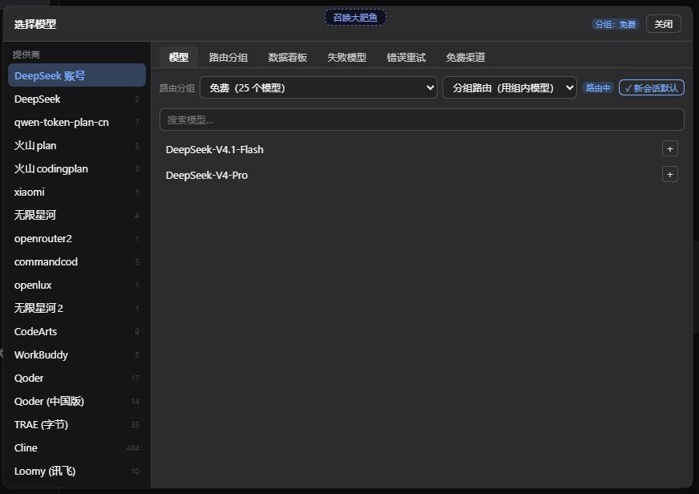
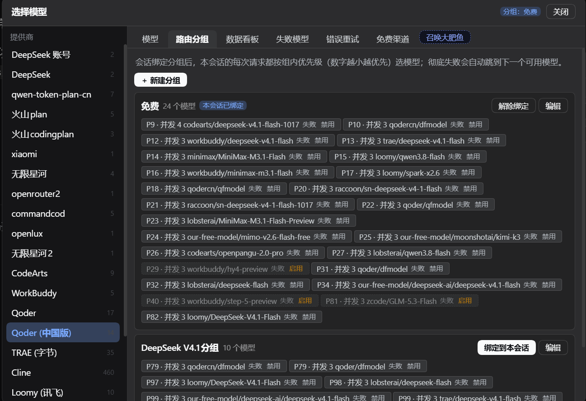
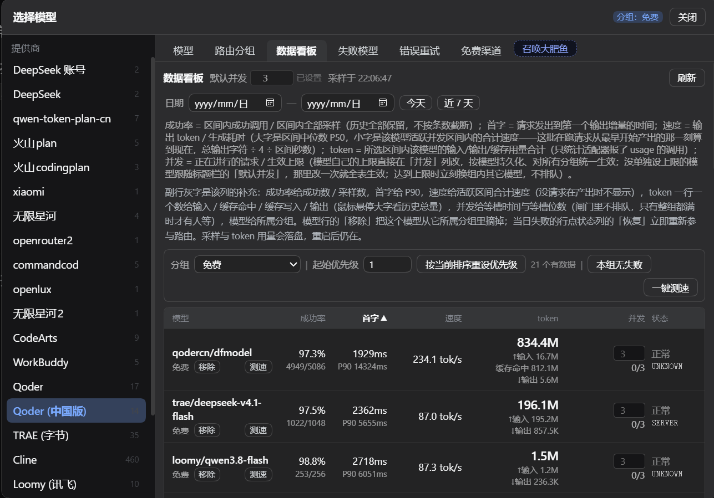
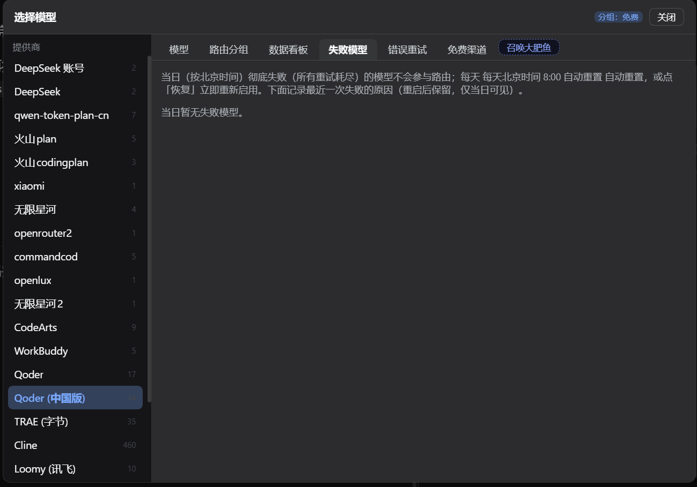
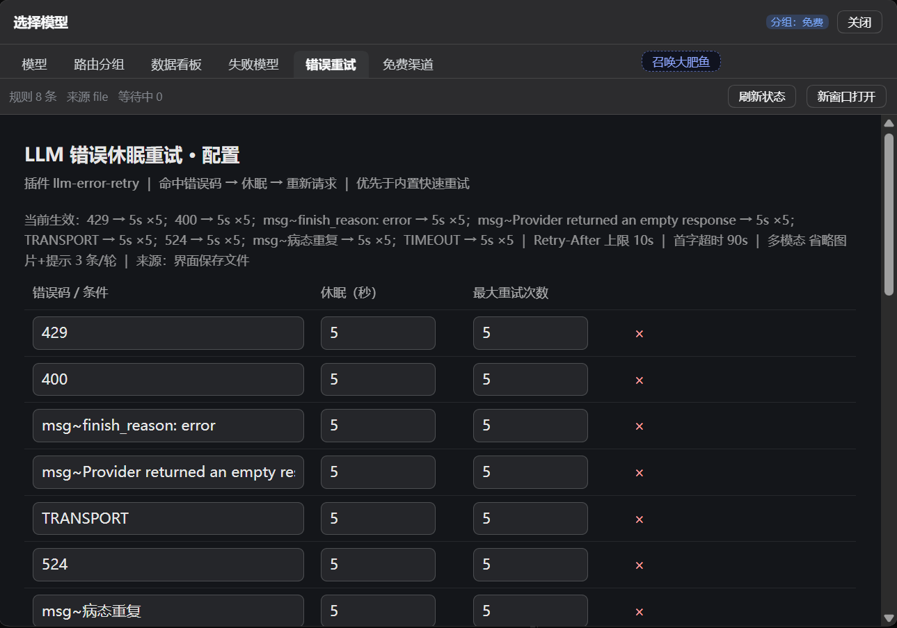
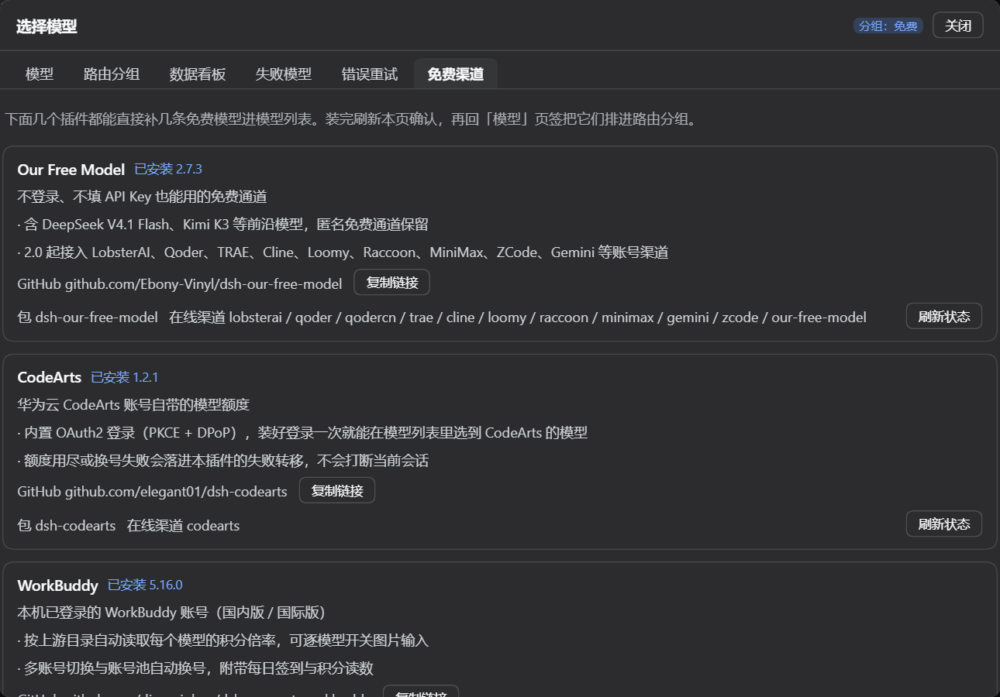

# Model Failover Manager

Replaces the composer's model seat with a grouped model picker that fails over to the next usable model once one has exhausted every retry.

One install brings two pieces: it depends on [dsh-llm-error-retry](https://github.com/liaoyuqing/dsh-llm-error-retry) and embeds that plugin's configuration page as a dialog tab, so retry rules are edited in one place.

The dialog's **Free channels** tab also gathers the six plugins that add free models, so one click puts dozens of models you can run without paying into the model list.

## The dialog



Seven tabs, ordered the way you actually triage:

| Tab | What it does |
| --- | --- |
| **Models** | Providers on the left, models on the right; add one to a group with ＋. The top bar picks the routing group, the binding mode, and the new-session default. |
| **Routing groups** | Each group is an ordered model list (lower priority number goes first), with active time windows, an expiry date, and per-model failed/disabled switches. Move a model up or down in place, or remove it from the group. |
| **Dashboard** | First-token latency, output speed, token usage, live concurrency and success rate per model; one-click speed tests and re-prioritising by the current sort. |
| **Failed models** | Today's exhausted models with the latest failure reason; restore one or all. |
| **Error retry** | dsh-llm-error-retry's own configuration page: rules, first-token timeout, Retry-After cap, max continuations. Saving applies immediately. |
| **Free channels** | Six plugins that add free models — Our Free Model / CodeArts / WorkBuddy / Trae / Qoder / Providers Hub — with a copyable GitHub address and one-click install; Our Free Model comes first and Providers Hub last. |
| **LAN** | Publishes routing groups over an OpenAI-compatible API for the local network: the `model` field is the route name, a total switch plus per-group switches decide what is exposed, and failures still fail over silently on the server. |









## Install

```sh
dsh plugin add https://github.com/liaoyuqing/model-failover-manager
```

This also installs `dsh-llm-error-retry` (a pinned dependency). Restart DSH afterwards and the model seat becomes the dialog; turn the dialog off in **Settings → Model Failover** to get the compact dropdown back.

Requires DSH `>=0.2.1-0 <0.3.0` (pre-releases such as rc/alpha included).

## What it solves

- **A failure no longer interrupts you.** Inner retry policies run first; once they all decline, the plugin records the model as failed for the day, switches to the next routable model in the group, and continues the same turn on its own — no manual resend.
- **Accounts and models are handled separately.** Our Free Model channels try another account first and only then switch models; a CodeArts pool poisoned by 401/403 is restarted through its own loader entry.
- **State is visible.** Which model failed today and why, first-token latency, concurrency, success rate — all on the dashboard, no log digging.
- **Free channels install in one click.** The six channel plugins install from the tab through the same engine the plugin market uses; each one adds a batch of free models that join your routing groups and fail over like any other.

## Free channel platforms it supports

The six cards cover **23 third-party platforms** — the **deduplicated union**, each platform counted once. The table below is exactly those 23 rows; the third column says which cards provide it, so a channel several plugins implement (Qoder is reachable through three) still occupies one row.

| # | Platform | Cards that provide it |
| --- | --- | --- |
| 1 | Qoder (Tongyi Lingma) | Our Free Model, Qoder, Providers Hub |
| 2 | TRAE (ByteDance) | Our Free Model, Trae, Providers Hub |
| 3 | Huawei Cloud CodeArts | CodeArts, Providers Hub |
| 4 | WorkBuddy | WorkBuddy, Providers Hub |
| 5 | Cline | Our Free Model, Providers Hub |
| 6 | Youdao LobsterAI | Our Free Model, Providers Hub |
| 7 | iFlytek Loomy | Our Free Model, Providers Hub |
| 8 | SenseTime Raccoon | Our Free Model, Providers Hub |
| 9 | MiniMax Code | Our Free Model, Providers Hub |
| 10 | Zhipu ZCode | Our Free Model, Providers Hub |
| 11 | Gemini Code Assist | Our Free Model, Providers Hub |
| 12 | Tencent CodeBuddy | Providers Hub |
| 13 | OpenCode | Providers Hub |
| 14 | OfficeAce | Providers Hub |
| 15 | Alibaba Accio | Providers Hub |
| 16 | iFlytek AStudio | Providers Hub |
| 17 | AutoClaw (Zhipu) | Providers Hub |
| 18 | ModelScope | Providers Hub |
| 19 | Qiniu | Providers Hub |
| 20 | Codely (Unity) | Providers Hub |
| 21 | MonkeyCode | Providers Hub |
| 22 | Baizhi Cloud | Providers Hub |
| 23 | MagiCrew | Providers Hub |

The "40+ routes" figure counts the same channels the other way: routes are provider ids in the registry, and a platform's domestic, international and enterprise editions each take one. Per card:

| Card | Package | Provider prefix | Routes |
| --- | --- | --- | --- |
| **Our Free Model** | `dsh-our-free-model` | `ofm-` | 1 main channel + 10 account channels (10 of the 23 platforms above) |
| **CodeArts** | `dsh-codearts` | `ca-` | 1 (Huawei Cloud CodeArts) |
| **WorkBuddy** | `dsh-connect-workbuddy` | `cw-` | 2 (domestic, international) |
| **Trae** | `dsh-connect-trae` | `ct-` | 3 (domestic, enterprise, international) |
| **Qoder** | `@dmh2002/dsh-connect-qoder` | `cq-` | 2 (domestic, international) |
| **Providers Hub** | `dsh-providers-hub` | `caa-` | 28 (covering the 23 platforms above, with Qoder, MiniMax Code, AutoClaw, MonkeyCode and MagiCrew each holding a domestic and an international route) |

1 + 10 + 1 + 2 + 3 + 2 + 28 = **47 routes**, landing on 23 platforms after deduplication. One platform provided by two plugins is normal rather than a mistake: an installed dedicated connector owns those ids, an absent one leaves them to the aggregators, so each id is counted in one place at a time (the claim rules are in the next section).

None of the platforms is implemented by this plugin: it installs them, lists them, and makes their models routable. Providers Hub claims exactly these provider ids: `caa-codearts`, `caa-buddy`, `caa-qoder`, `caa-qodercn`, `caa-workbuddy`, `caa-lobsterai`, `caa-trae`, `caa-cline`, `caa-loomy`, `caa-raccoon`, `caa-minimax`, `caa-minimaxintl`, `caa-zcode`, `caa-opencode`, `caa-gemini`, `caa-officeace`, `caa-accio`, `caa-astudio`, `caa-autoclaw`, `caa-autoclawintl`, `caa-modelscope`, `caa-qiniu`, `caa-codely`, `caa-monkeycode`, `caa-monkeycodeintl`, `caa-baizhi`, `caa-magicrew`, `caa-magicrewintl`.

**Only Our Free Model needs no login.** Its built-in anonymous channel works without an account or an API key; the other five expect you to already have an account on that platform (or its desktop client signed in on this machine) and merely route that quota into DSH. On desktop there is also an EAC co-payment channel.
## Free channels tab



Each recommendation adds a few models you can run without paying. The card order is fixed, with Our Free Model on top — the only one that needs neither a login nor an API key — and Providers Hub last:

- **Our Free Model** (`dsh-our-free-model`): a no-login, no-API-key channel including DeepSeek V4.1 Flash and Kimi K3, which also routes LobsterAI, Qoder, TRAE, Cline, Loomy, Raccoon, MiniMax, ZCode and Gemini accounts since 2.0.
- **CodeArts** (`dsh-codearts`): models bundled with a Huawei Cloud CodeArts account, with built-in OAuth2 login (PKCE + DPoP).
- **WorkBuddy** (`dsh-connect-workbuddy`): the WorkBuddy account already signed in on this machine (domestic / international), with per-model rate multipliers, account switching and daily check-in.
- **Trae** (`dsh-connect-trae`): the Trae desktop account already signed in on this machine; domestic, enterprise and international each register a provider, with daily check-in and credit readouts.
- **Qoder** (`@dmh2002/dsh-connect-qoder`): a Qoder account's model quota through a single PAT, with a multi-account pool and automatic switching; domestic and international can run side by side.
- **Providers Hub** (`dsh-providers-hub`, formerly `dsh-codearts-auth`): the accounts of more than twenty free channels through one plugin (the list is in the previous section); one login puts that channel's models in the model list, with a multi-account pool, silent renewal and a local OpenAI-compatible gateway.

Three separate facts per card: **installed** (read from the profile dependencies), **providers online** (read from the live `llm` registry), and the **GitHub address** (one click to copy). A channel that is installed but not logged in therefore never reads as "not installed".

Trae and Qoder are dedicated connectors whose provider ids overlap with the ones the aggregators register for the same accounts: an installed connector owns them, an absent one leaves them to the aggregators, so no id is counted twice and none disappears.

Providers Hub is the second aggregator: a claim goes to a dedicated connector (`codearts`, `workbuddy`, `trae`, `qoder`) first, then to the aggregators in card order — Our Free Model before Providers Hub — so Our Free Model keeps the bulk and Providers Hub gets only what nobody claimed. Its own provider pattern leaves out `codearts` and `workbuddy`, so those ids stay on their dedicated cards.

The install button calls the host's `pluginManager.installBundle` — the same path as the plugin market and `dsh plugin add`. When a package needs its install scripts approved the tab reports the pending builds and never approves on your behalf. Installed channels show up in the Models tab and can join a routing group like any other model.

Providers Hub installs under the spec `dsh-providers-hub`, the name the plugin market lists it under (its GitHub address points at the upstream `iJetLi/dsh-providers-hub` repository; the market page offers a GitHub-source command, while the tab uses the npm package of the same name). The package was renamed from `dsh-codearts-auth` at 0.2.0-rc.11 and both npm names are published at the same version; a profile that still has the old name installed is reported as installed and needs no reinstall.

Install specs are registry package names on purpose: a `github:` source pulls a whole-repository tarball (83 MB for Our Free Model) that pnpm re-fetches on every profile install, which is what drags the market's own updates past their timeout on a slow GitHub day.

## When several channels share a provider name

The six channel plugins register overlapping provider ids, so each carries its own prefix (`ofm-`, `ca-`, `cw-`, `ct-`, `cq-`, `caa-`) applied to both the id and the display name: the model tab shows `ca-CodeArts` or `ofm-Qoder`, so it is obvious which route a row belongs to. The plugins themselves are untouched, and group files, configuration and the failed-model table keep the bare ids.

Compression is transparent to prefixes — the compaction guard, the qoder and trae compression shims and the CodeArts self-heal all normalise an id to its bare name before deciding, so prefixed models still get context compression. The one place that must not be prefixed is the account `provider` field in Jet Hub's store (`jet-hub/state.json`): billion-context enumerates resign credentials by a literal `codearts`, so a prefixed value leaves it with no credential.

## Full documentation

Configuration keys, the `/api/model-failover` endpoints, the failover decision order, and the qoder compression shim (including how to tell whether compression is actually happening) are documented in the repository [README](README.md).
