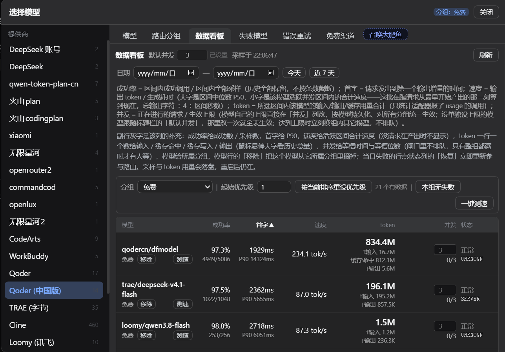
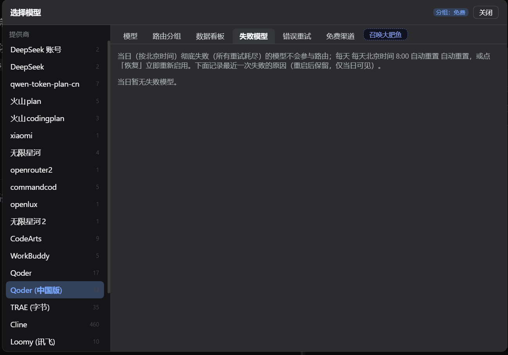
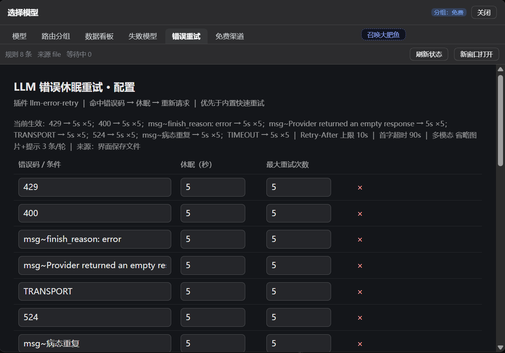
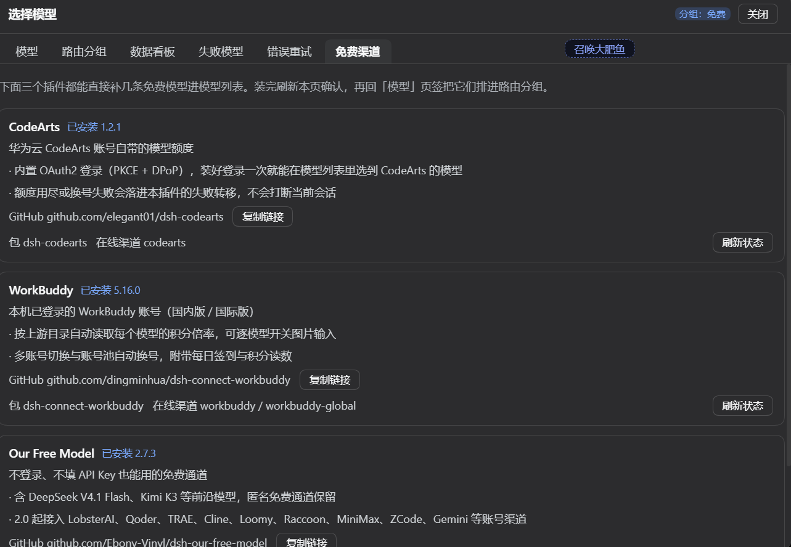

# Model Failover Manager

Replaces the composer's model seat with a grouped model picker that fails over to the next usable model once one has exhausted every retry.

One install brings two pieces: it depends on [dsh-llm-error-retry](https://github.com/liaoyuqing/dsh-llm-error-retry) and embeds that plugin's configuration page as a dialog tab, so retry rules are edited in one place.

## The dialog


Six tabs, ordered the way you actually triage:

| Tab | What it does |
| --- | --- |
| **Models** | Providers on the left, models on the right; add one to a group with ＋. The top bar picks the routing group, the binding mode, and the new-session default. |
| **Routing groups** | Each group is an ordered model list (lower priority number goes first), with active time windows, an expiry date, and per-model failed/disabled switches. |
| **Dashboard** | First-token latency, output speed, token usage, live concurrency and success rate per model; one-click speed tests and re-prioritising by the current sort. |
| **Failed models** | Today's exhausted models with the latest failure reason; restore one or all. |
| **Error retry** | dsh-llm-error-retry's own configuration page: rules, first-token timeout, Retry-After cap, max continuations. Saving applies immediately. |
| **Free channels** | Three plugins that add free models — CodeArts / WorkBuddy / Our Free Model — with a copyable GitHub address and one-click install. |








## Install

```sh
dsh plugin add https://github.com/liaoyuqing/model-failover-manager
```

This also installs `dsh-llm-error-retry` (a pinned dependency). Restart DSH afterwards and the model seat becomes the dialog; turn the dialog off in **Settings → Model Failover** to get the compact dropdown back.

Requires DSH `>=0.2.1-0 <0.3.0` (pre-releases such as rc/alpha included).

## What it solves

- **A failure no longer interrupts you.** Inner retry policies run first; once they all decline, the plugin records the model as failed for the day, switches to the next routable model in the group, and continues the same turn on its own — no manual resend.
- **Accounts and models are handled separately.** Our Free Model channels try another account first and only then switch models; a CodeArts pool poisoned by 401/403 is restarted through its own loader entry.
- **State is visible.** Which model failed today and why, first-token latency, concurrency, success rate — all on the dashboard, no log digging.
- **Free channels install in one click.** CodeArts, WorkBuddy and Our Free Model install from the tab through the same engine the plugin market uses.

## Free channels tab



Each recommendation adds a few models you can run without paying:

- **CodeArts** (`dsh-codearts`): models bundled with a Huawei Cloud CodeArts account, with built-in OAuth2 login (PKCE + DPoP).
- **WorkBuddy** (`dsh-connect-workbuddy`): the WorkBuddy account already signed in on this machine (domestic / international), with per-model rate multipliers, account switching and daily check-in.
- **Our Free Model** (`dsh-our-free-model`): a no-login, no-API-key channel including DeepSeek V4.1 Flash and Kimi K3.

Three separate facts per card: **installed** (read from the profile dependencies), **providers online** (read from the live `llm` registry), and the **GitHub address** (one click to copy). A channel that is installed but not logged in therefore never reads as "not installed".

The install button calls the host's `pluginManager.installBundle` — the same path as the plugin market and `dsh plugin add`. When a package needs its install scripts approved the tab reports the pending builds and never approves on your behalf. Installed channels show up in the Models tab and can join a routing group like any other model.

## Full documentation

Configuration keys, the `/api/model-failover` endpoints, the failover decision order, and the qoder compression shim (including how to tell whether compression is actually happening) are documented in the repository [README](README.md).
