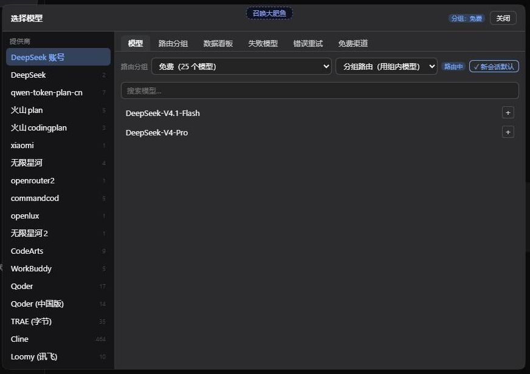
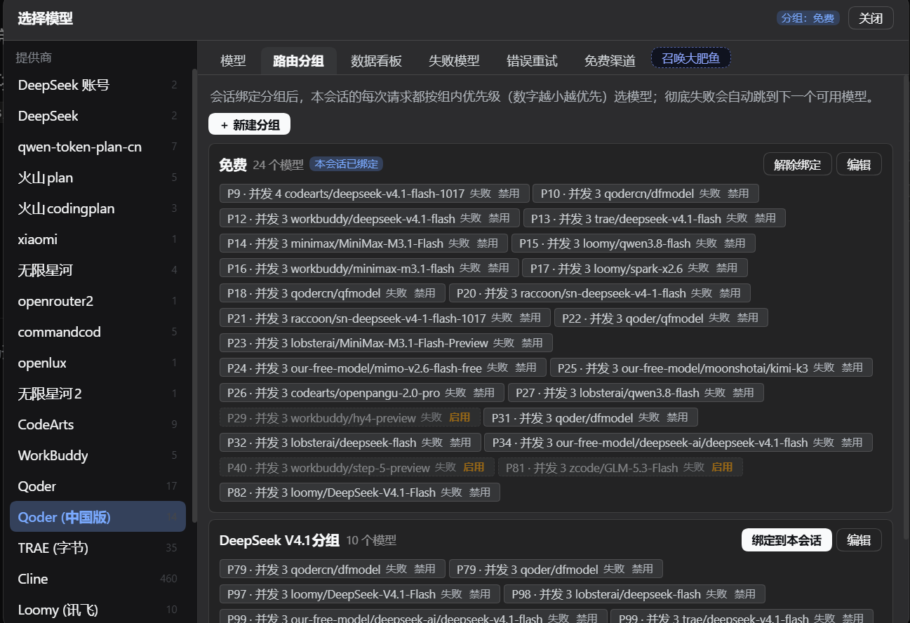
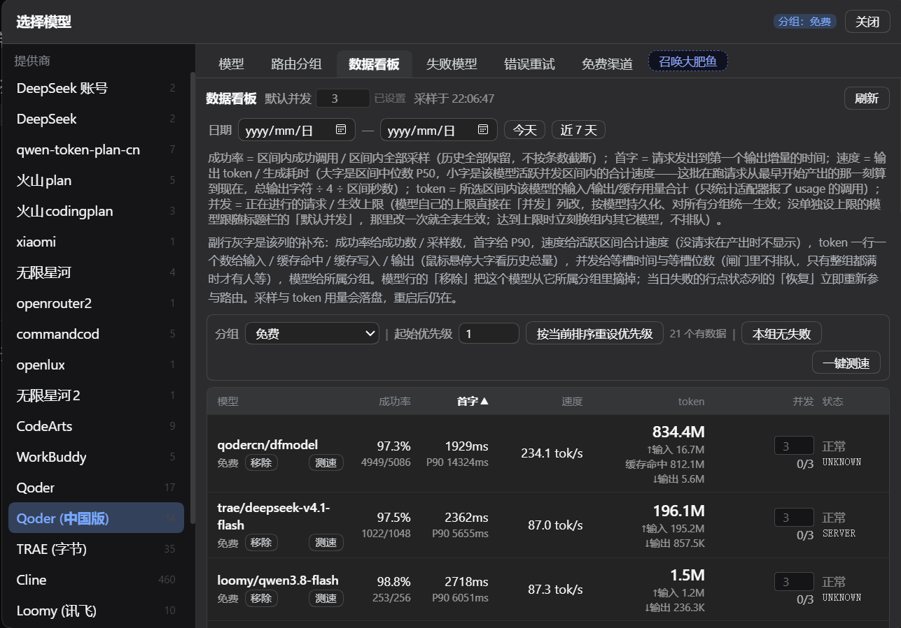
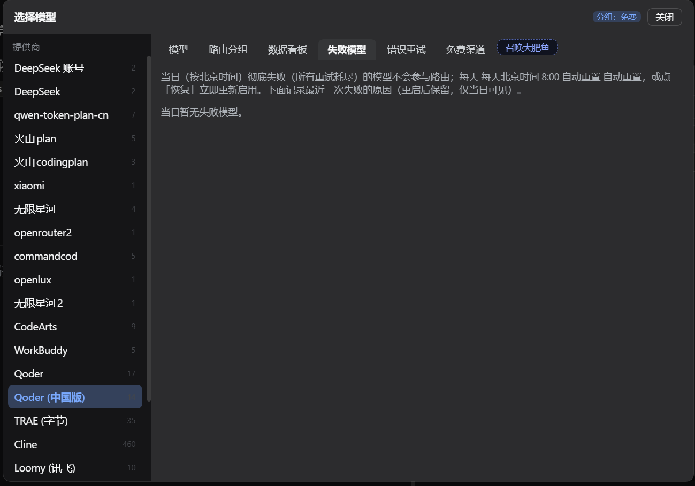
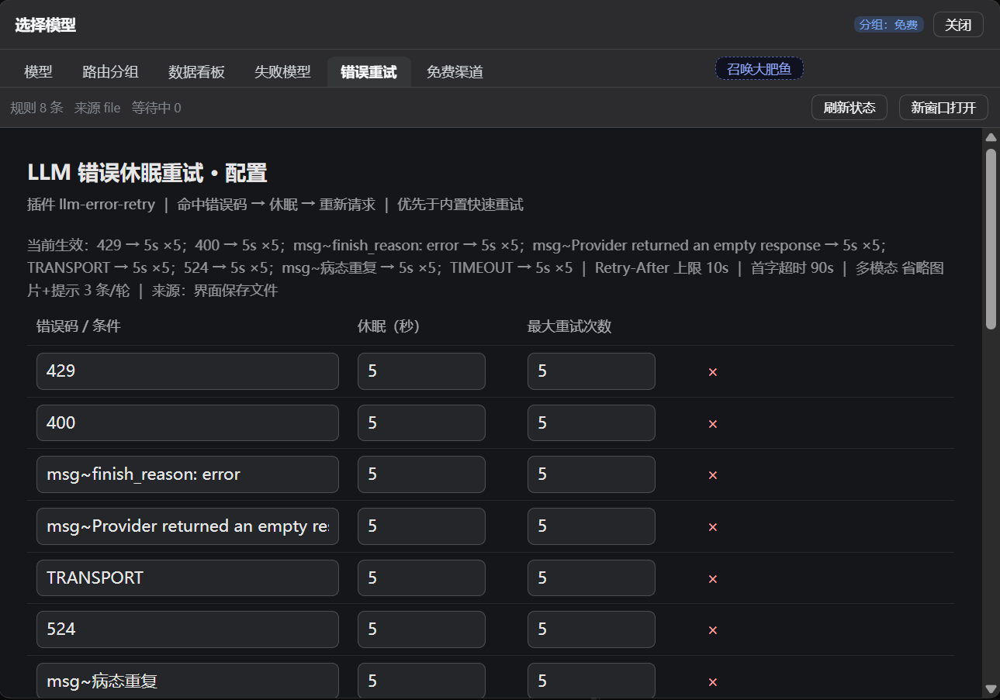
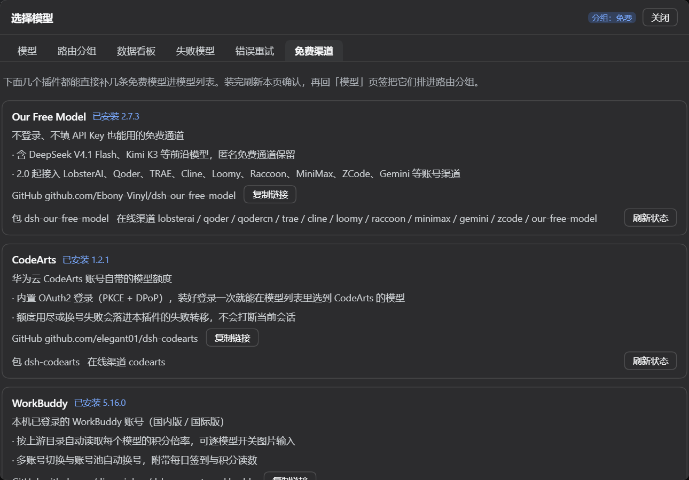

# 模型故障转移管理

把 composer 的模型选择位换成带**路由分组**的选择弹窗，并在模型彻底失败（所有重试都放弃）后自动切到组内下一个可用模型。
一次安装带两件：依赖 [dsh-llm-error-retry](https://github.com/liaoyuqing/dsh-llm-error-retry)，并在弹窗里内嵌它的配置页 —— 重试规则不用另开一个界面改。
弹窗里的**免费渠道**页签还把六个能直接补免费模型的插件聚在一起，一键装上就能让模型列表多出几十条可以白跑的模型。

## 界面



弹窗有六个页签，按你排障时的动线排列：

| 页签 | 做什么 |
| --- | --- |
| **模型** | 左栏供应商、右栏模型，点 ＋ 加进分组；顶部选路由分组、绑定模式，以及「新会话默认」 |
| **路由分组** | 每组一份有序模型清单（数字越小越先试），可配生效时段与截止日，就地 ↑ ↓ 调优先级、✕ 移出分组，逐个开关「失败」「禁用」 |
| **数据看板** | 每个模型的首字延迟、输出速度、token 用量、并发现场、成功率；可一键测速、按当前排序重设优先级 |
| **失败模型** | 当日彻底失败的模型与最近一次失败原因，逐个或一键全部恢复 |
| **错误重试** | 内嵌 dsh-llm-error-retry 自己的配置页：规则、首字超时、Retry-After 上限、最大续写，保存即生效 |
| **免费渠道** | Our Free Model / CodeArts / WorkBuddy / Trae / Qoder / Providers Hub 六个能直接补免费模型的插件，带 GitHub 地址（一键复制）与一键安装；Our Free Model 排第一张，Providers Hub 排最后一张 |









## 安装

```sh
dsh plugin add https://github.com/liaoyuqing/model-failover-manager
```

这一条会把 `dsh-llm-error-retry` 一起装上（它在 `dependencies` 里，固定到具体 commit）。装完重启 DSH，模型位就会变成弹窗；不想用弹窗可以在 **设置 → 模型故障转移** 里关掉，退回紧凑下拉。
要求 DSH `>=0.2.1-0 <0.3.0`（含 rc/alpha 等预发布）。

## 它解决什么

- **失败不再打断你**：一次失败，内层重试先按规则重试；全都放弃后本插件标记该模型当日失败、切到组内下一个可用模型，并自动续跑当前这一轮 —— 不用手动重发。
- **账号和模型分开处理**：Our Free Model 的渠道先尝试换账号，账号试完才换模型；CodeArts 池被 401/403 打成「无可用账号」时自动重启它自己的 Loader 条目自救。
- **状态看得见**：哪个模型今天失败过、为什么失败、首字多慢、并发多少、成功率如何，都在看板里，不用翻日志。
- **免费渠道一步装上**：六个渠道插件在页签里直接安装，走的是插件市场同一个引擎；装上一个就多一批免费模型，接进路由分组后自动参与失败转移。

## 支持的免费渠道平台

六张卡片合计覆盖 **23 个第三方平台** —— 这是**去重后的并集**，一个平台只算一次。下面这张表就是那 23 行；第三列说明它由哪几张卡片提供，同一条渠道被多个插件重复实现时（比如 Qoder 三张卡片都能接），这里仍然只占一行。

| # | 平台 | 由哪些卡片提供 |
| --- | --- | --- |
| 1 | Qoder（通义灵码） | Our Free Model、Qoder、Providers Hub |
| 2 | TRAE（字节） | Our Free Model、Trae、Providers Hub |
| 3 | 华为云 CodeArts | CodeArts、Providers Hub |
| 4 | WorkBuddy | WorkBuddy、Providers Hub |
| 5 | Cline | Our Free Model、Providers Hub |
| 6 | 有道 LobsterAI | Our Free Model、Providers Hub |
| 7 | 讯飞 Loomy | Our Free Model、Providers Hub |
| 8 | 商汤 Raccoon | Our Free Model、Providers Hub |
| 9 | MiniMax Code | Our Free Model、Providers Hub |
| 10 | 智谱 ZCode | Our Free Model、Providers Hub |
| 11 | Gemini Code Assist | Our Free Model、Providers Hub |
| 12 | 腾讯 CodeBuddy | Providers Hub |
| 13 | OpenCode | Providers Hub |
| 14 | OfficeAce | Providers Hub |
| 15 | 阿里 Accio | Providers Hub |
| 16 | 讯飞 AStudio | Providers Hub |
| 17 | AutoClaw（智谱） | Providers Hub |
| 18 | 魔搭 ModelScope | Providers Hub |
| 19 | 七牛云 Qiniu | Providers Hub |
| 20 | Codely（Unity） | Providers Hub |
| 21 | MonkeyCode | Providers Hub |
| 22 | 百智云 | Providers Hub |
| 23 | 超级麦吉 MagiCrew | Providers Hub |

至于「40 多条路由」是同一批渠道的另一种数法：路由按注册表里的 provider id 数，同一个平台的国内版 / 国际版 / 企业版各占一条。按卡片拆开就是：

| 卡片 | 插件包 | provider 前缀 | 路由数 |
| --- | --- | --- | --- |
| **Our Free Model** | `dsh-our-free-model` | `ofm-` | 主通道 1 条 + 账号渠道 10 条（上面 23 个平台里的 10 个） |
| **CodeArts** | `dsh-codearts` | `ca-` | 1 条（华为云 CodeArts） |
| **WorkBuddy** | `dsh-connect-workbuddy` | `cw-` | 2 条（国内版 / 国际版） |
| **Trae** | `dsh-connect-trae` | `ct-` | 3 条（国内版 / 企业版 / 国际版） |
| **Qoder** | `@dmh2002/dsh-connect-qoder` | `cq-` | 2 条（国内版 / 国际版） |
| **Providers Hub** | `dsh-providers-hub` | `caa-` | 28 条（覆盖上面 23 个平台，其中 Qoder、MiniMax Code、AutoClaw、MonkeyCode、超级麦吉 MagiCrew 各占国内 / 国际两条） |

1 + 10 + 1 + 2 + 3 + 2 + 28 = **47 条路由**，去重后落在 23 个平台上。一个平台被两个插件同时提供是常态而不是错误：装上专用连接器后那些 id 归它，没装则留给聚合渠道，同一时刻只算一处（下面「免费渠道页签」一节讲认领规则）。

这些平台都不是本插件自己实现的，本插件只负责把它们装起来、列出来、并让它们的模型能进路由分组。Providers Hub 认领的 provider id 是 `caa-codearts`、`caa-buddy`、`caa-qoder`、`caa-qodercn`、`caa-workbuddy`、`caa-lobsterai`、`caa-trae`、`caa-cline`、`caa-loomy`、`caa-raccoon`、`caa-minimax`、`caa-minimaxintl`、`caa-zcode`、`caa-opencode`、`caa-gemini`、`caa-officeace`、`caa-accio`、`caa-astudio`、`caa-autoclaw`、`caa-autoclawintl`、`caa-modelscope`、`caa-qiniu`、`caa-codely`、`caa-monkeycode`、`caa-monkeycodeintl`、`caa-baizhi`、`caa-magicrew`、`caa-magicrewintl`。

**免登录的只有 Our Free Model 一条。** 它内置的匿名免费通道不登录、不填 API Key 就能用；其余五个都要求你已经有对应平台的账号（或者本机已经登录了它的桌面客户端），插件只是把那份额度接进 DSH。桌面端另有 EAC 协付渠道。
## 免费渠道页签



六个推荐渠道都能让模型列表多出几条可以白跑的模型，卡片顺序固定，Our Free Model 在最上面（只有它不登录、不填 Key 就能用），Providers Hub 在最后一张：

- **Our Free Model**（`dsh-our-free-model`）：不登录、不填 API Key 的免费通道，含 DeepSeek V4.1 Flash、Kimi K3 等；2.0 起也接 LobsterAI、Qoder、TRAE、Cline、Loomy、Raccoon、MiniMax、ZCode、Gemini 十个账号渠道。
- **CodeArts**（`dsh-codearts`）：华为云 CodeArts 账号自带的模型额度，内置 OAuth2 登录（PKCE + DPoP）。
- **WorkBuddy**（`dsh-connect-workbuddy`）：本机已登录的 WorkBuddy 账号（国内版 / 国际版），按上游目录读积分倍率，支持换号与每日签到。
- **Trae**（`dsh-connect-trae`）：本机已登录的 Trae 桌面端账号，国内版 / 企业版 / 国际版各注册一个 provider，附每日签到与积分读数。
- **Qoder**（`@dmh2002/dsh-connect-qoder`）：Qoder（通义灵码）账号额度，只需一个 PAT（`pt-` 开头），支持多账号池与自动换号，国内版与国际版可同时启用。
- **Providers Hub**（`dsh-providers-hub`，旧名 `dsh-codearts-auth`）：一个插件接入二十多家免费渠道的账号（清单见上一节），登录一次就在模型列表里多出该渠道的模型；带多账号池、静默续期与本地 OpenAI 兼容网关。

卡片上三件事分开写清楚：**装没装**（读 profile 依赖）、**在线渠道**（读当前 llm 注册表）、**GitHub 地址**（一键复制）。所以「装了但没登录」不会显示成「没装」。

Trae 与 Qoder 是专用连接器，与 Our Free Model 内置的同名渠道撞号：专用连接器装了，`trae` / `qoder` 这类 provider 就归它；没装则留给聚合渠道。同一时刻只算一次，两张卡片不会重复计数，也不会凭空丢渠道。

Providers Hub 是第二个聚合渠道，认领顺序是专用连接器（`codearts` / `workbuddy` / `trae` / `qoder`）在前，然后聚合渠道按推荐表顺序认领：Our Free Model 先、Providers Hub 后，所以 Our Free Model 仍拿大头，Providers Hub 只拿没人认领的那些。它的 provider 正则不含 `codearts` 与 `workbuddy`，这两个 id 因此仍只算在专用卡片上。

安装按钮调的是宿主的 `pluginManager.installBundle` —— 与插件市场、`dsh plugin add` 同一条路径。需要批准构建脚本时只回报待批准项，**不代批**。装好之后它们的模型会出现在「模型」页签里，排进路由分组即可参与失败切换。

Providers Hub 的安装 spec 用插件市场里这条的包名 `dsh-providers-hub`（GitHub 地址指向上游 `iJetLi/dsh-providers-hub` 仓库；市场页给的是 GitHub 源命令，这里走 npm 同名包）。这个包 0.2.0-rc.11 起从 `dsh-codearts-auth` 改名，npm 上两个包名同发同版本；之前装过旧名的 profile 照样显示「已安装」，不用重装。

安装 spec 一律用 npm 包名：`github:` 源要拉整个仓库的 tarball（Our Free Model 那份 83MB），pnpm 每次安装 profile 都会重拉一遍，GitHub 一慢就把插件市场的更新拖过 15 分钟上限。

## 多个同名渠道并存时

六个渠道插件会往注册表注册同名的 provider，所以每个插件各带一个前缀（`ofm-` / `ca-` / `cw-` / `ct-` / `cq-` / `caa-`），id 与显示名一起加：模型页签里会显示成 `ca-CodeArts`、`ofm-Qoder` 这种，一眼能看出是哪条路由。插件自身的代码不用改，分组文件、配置与失败表里仍是裸 id。

压缩链路对前缀是透明的——守卫、qoder / trae 压缩 shim、CodeArts 自救都先把 id 剥成裸名再判定，所以打了前缀的模型照样有上下文压缩。唯一不能加前缀的是 Jet Hub 账户库（`jet-hub/state.json`）里的 `provider` 字段，那里必须留裸 `codearts`，否则 billion-context 找不到重签凭据。

## 完整文档

配置项、`/api/model-failover` 接口、失败切换的判定顺序、qoder 压缩 shim 的取舍与排障方法，见仓库里的 [README](README.md)。
